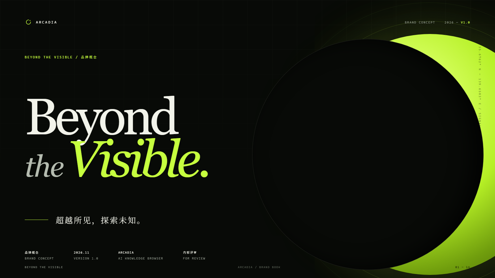

# Beyond the Visible

**Arcadia 品牌概念提案 · V1.0**
超越所见，探索未知。

---

## 一句话

Arcadia 不制造更多信息，而是让信息背后原本不可见的结构显影。

这不是一句关于 AI 的宣言，而是一句关于“看见”的承诺：网页是表面，来源、上下文、分歧与关联在表面之下；浏览器的价值，不在于让你看得更多，而在于让你看得更清楚、追得更远、留得更久。

## 背景：信息丰盛，理解昂贵

我们每天穿过数百个页面，却很少真正抵达一个结论。问题不在于看得不够多，而在于看不见页面之间的关系。当信息失去结构，浏览就变成了漂流。

浏览器一直擅长把世界摊开在我们眼前。Arcadia 想做的，是让你看见摊开之后的东西。

## 品牌角色：不是入口，而是出口

大多数浏览器把自己定义为“信息的入口”：更快地打开，更多地聚合，更久地停留。

Arcadia 的角色是“理解的出口”：从一篇网页出发，经过阅读、保存、检索、引用与再访问，最终形成一个可以带走的判断。品牌因此不强调“更多”，而强调三种动作：**取景、追溯、留存**。

## 核心隐喻：光圈与显影

品牌的核心意象是一台光学仪器。

- **光圈**决定什么进入视野。好的浏览不是全盘接收，而是有意识地取景。
- **对焦**把模糊变成清晰。AI 的价值不是替你读，而是帮你把关系对焦。
- **显影**让原本存在但不可见的东西浮现。知识早已在页面之间，只需要一道恰当的光。
- **地平线**标记已知与未知的边界。品牌永远站在边界上，朝未知再走一步。

对应到标志：一个未闭合的圆。圆是完整的知识；缺口是尚未看见的部分；点是此刻的焦点；细线是已知与未知之间的地平线。

## 定位

> 为以阅读为思考方式的人，造一台看见结构的浏览器。

Arcadia 是一款本地优先的 AI 知识浏览器。它把浏览、阅读、保存、检索与引用问答连成一条连续的认知路径——让每一次打开网页，都成为一次积累，而不是一次丢失。

| | |
| --- | --- |
| **品类** | AI knowledge browser / AI 知识浏览器 |
| **人群** | 研究者、分析师、设计师、写作者，以及以阅读为工作方式的人 |
| **差异** | 本地优先 · 强制引用 · 连续工作流 |
| **承诺** | 看得更远，也追得回来 |

## 三个品牌支柱

### 01 取景 / FOCUS
在无限的信息里，决定什么值得被看见。界面克制，Reader 还原正文，AI 不抢走注意力。

`LESS NOISE. MORE SIGNAL.`

### 02 追溯 / TRACE
每一个结论，都能回到它出发的地方。强制引用、来源可查、原文可回访。

`SHOW THE SOURCE, NOT JUST THE ANSWER.`

### 03 留存 / KEEP
知识留在设备上，也留在时间里。本地 SQLite，Markdown 可带走，不被平台锁定。

`LOCAL BY DEFAULT. YOURS BY DESIGN.`

## 语言

品牌像一个可靠的同行者：读过很多，但不急着下结论。

- **准确先于漂亮。** 宁可少说，也不说过头。
- **克制是一种尊重。** 留白，让读者自己完成判断。
- **永远给出处。** 结论与证据一起出现。
- **用动词，不用形容词。** 说 reveal、trace、keep，不说“革命性”“无缝”“颠覆”。

### 标语系统

| 场景 | 英文 | 中文 |
| --- | --- | --- |
| 母品牌 | Beyond the Visible. | 超越所见，探索未知。 |
| 产品 | Read between the pages. | 在页面之间，读出答案。 |
| AI | Every answer has a source. | 每个答案，都有出处。 |
| 隐私 | Your knowledge stays yours. | 你的知识，只属于你。 |
| 传播 | See further. | 看得更远。 |

**说：** “让答案回到来源。” / “把网页，变成可以再次使用的知识。”
**不说：** “颠覆你的阅读方式。” / “无缝、极致、革命性的 AI 体验。”

## 视觉识别

### 标志：The Aperture

一个未闭合的圆，缺口朝向右上——阅读与前进的方向。

- 直径 300，环宽 34，开口 72°
- 焦点圆点 r=30，位于缺口中心，而非圆心
- 地平线位于标志基线下方，划分已知与未知
- 缺口可以缓慢旋转，作为“正在对焦”的状态；静止时永远是品牌的主形态

### 色彩

| Token | 色值 | 占比 | 用途 |
| --- | --- | --- | --- |
| Void | `#080A07` | 68% | 背景、深色界面、未知 |
| Signal | `#C6FF3D` | 18% | 焦点、引用、确认、当前状态 |
| Bone | `#F2F3EA` | 10% | 阅读底色、标题、留白 |
| Ash | `#8F978B` | 4% | 注释、坐标、次要信息 |

**规则：** 一个画面只允许一个 Signal 焦点。不要用 Signal 铺满背景，除非是品牌收束页。

### 字体

- **Display — 思源宋体 / Noto Serif SC**：思想、时间与留白。用于标题、引文、品牌语句。
- **Interface — 思源黑体 / Noto Sans SC**：清晰、中性、可操作。用于界面与正文。
- **Evidence — Cascadia Mono**：坐标、来源与数据。只出现在证据旁边。

衬线体承载“想法”，无衬线体承载“动作”，等宽体承载“证据”。三者的分工，就是品牌在界面里的秩序。

### 图形系统

- **Horizon**：一条 61.8% 的地平线，划分已知与未知。
- **Aperture**：图像只在圆环中局部显影，其余留给想象。
- **Contour**：知识不是列表，是地形；用等高线表达密度。
- **Coordinate**：细小的编号、刻度与坐标，让品牌像一台仪器。

### 动效

标志性动作是 **Focus Pull**：内容从 12px 模糊与 1.05 倍缩放中浮现，在 720ms 内变得清晰。

- `720ms · cubic-bezier(.22,1,.36,1) · blur 12→0 · scale 1.05→1`
- **Aperture Wipe**：560ms，从焦点向外展开的圆形遮罩
- **Reduced Motion**：仅保留透明度变化，取消位移与模糊

动效不是表演，是让因果关系可见。

## 应用原则

1. **品牌退后，阅读向前。** 界面里不放大标志，不叠加纹理，不用品牌色抢内容的注意力。
2. **每个画面一个焦点。** 一个 Signal 色、一个主标题、一个动作。
3. **中英文对等。** 中文不是英文的装饰，英文也不是中文的翻译；两种语言各自成立。
4. **留白是内容。** 至少 40% 的负空间；宁可少一个模块，不要多一条线。
5. **永远保留来源。** 这是品牌承诺，也是界面规则：答案旁边必须有证据。

## 文件

| 文件 | 说明 |
| --- | --- |
| [arcadia-beyond-the-visible.pdf](arcadia-beyond-the-visible.pdf) | 14 页品牌概念书，1600 × 900，可直接评审/打印 |
| [index.html](index.html) | 品牌书源文件，可继续编辑；`?slide=1…14` 单页预览 |
| [book.css](book.css) | 品牌书版式与视觉系统 |
| [assets/mark.svg](assets/mark.svg) | 主标志（透明背景） |
| [assets/app-icon.svg](assets/app-icon.svg) | 应用图标 |
| [assets/lockup.svg](assets/lockup.svg) | 横向组合标志 |
| [slides/](slides/) | 14 张页面预览图 |
| [tokens.css](tokens.css) | 可落地的设计变量（颜色、字体、动效） |

---

> 本提案把 “Beyond the Visible” 作为 Arcadia 的品牌平台与传播概念，而不是产品改名。现有桌面应用与官网的代码、品牌资产未被修改。
