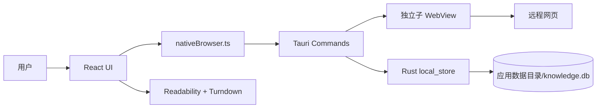
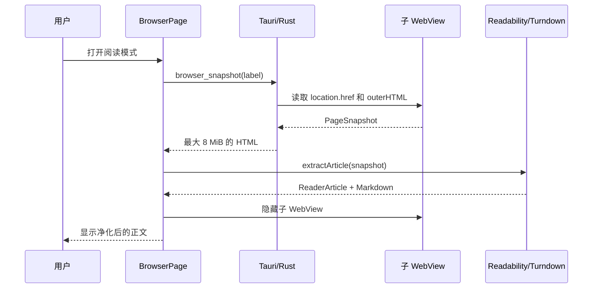
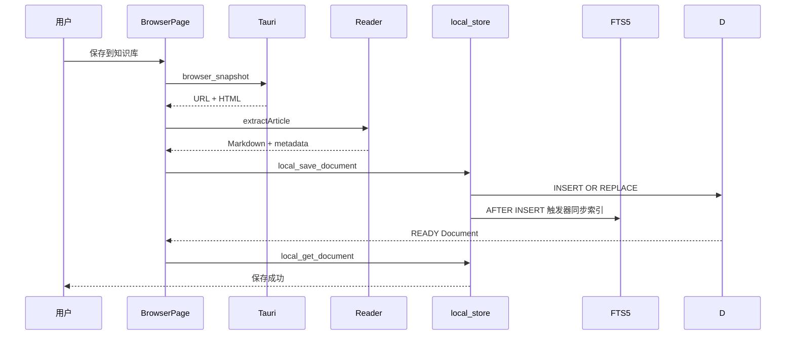
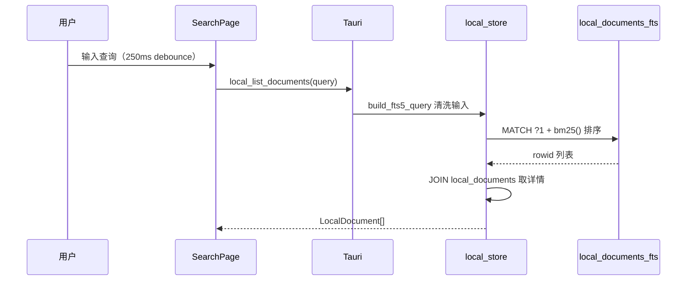

# Arcadia 开发技术文档

> 文档状态：基于 `main` 分支当前实现整理  
> 应用版本：`0.1.0`（`tauri.conf.json`；`desktop/package.json` 为 `0.3.0`，两者尚未统一）  
> 最后校验：2026-10-27

## 1. 文档目的

本文档面向参与 Arcadia（AI Knowledge Browser）开发、测试、维护和架构演进的工程师，描述当前代码真实实现，而不是仅描述产品愿景。

Arcadia 是一个基于 Tauri 2 的本地优先桌面知识浏览器。当前已打通以下核心闭环：

1. 在独立原生 WebView 中浏览网页。
2. 使用 Mozilla Readability 提取正文。
3. 将正文转换成 Markdown。
4. 保存到桌面应用的本地 SQLite，并同步 FTS5 索引。
5. 在知识库和搜索页面读取、查看和删除文档。
6. 基于本地语料做混合检索与带引用的 RAG 问答。

AI Provider、RAG、隐私拦截、WASM 插件运行时和受控 Agent 均已实现；跨设备同步与插件市场尚未开始。各迭代状态见 [开发路线图](roadmap.md)。

## 2. 技术栈

| 层 | 技术 | 当前职责 |
| --- | --- | --- |
| 桌面 UI | React 19、TypeScript、Vite 6、SCSS | 页面、标签状态、阅读器、知识库和设置界面 |
| UI 组件层 | `components/ui/`（`@base-ui/react` + `lucide-react`） | 对外暴露对齐 Ant Design 用法的组件；**不依赖 `antd` 包** |
| 桌面壳 | Tauri 2、Rust | 子 WebView、受控导航、页面快照、本地 SQLite、应用打包 |
| 内容处理 | Mozilla Readability、Turndown、React Markdown + remark-gfm | 正文识别、HTML 清理、Markdown 转换和展示 |
| 持久化 | `rusqlite`（bundled） + SQLite **FTS5** | 26 个顺序迁移；文档、标签、集合、任务、Provider、下载、历史、书签、工作区、阅读活动、凭证、RAG、Agent、插件、隐私统计 |
| 检索 | 自实现 BM25 / 向量索引 / RRF / Reranker / 引用校验 | 混合召回与带引用的问答 |
| Provider | `reqwest` + `rustls-tls`（流式） | OpenAI Compatible、Ollama、Embedding |
| 插件 | `wasmtime`（component-model + cranelift） | WASI Preview 2 组件运行时，Fuel / 内存 / 超时隔离 |
| 密钥 | `keyring` | Credential Manager / Keychain / Secret Service |
| 测试 | Vitest、Cargo test | 前端 61 文件 / 468 用例；Rust 243 用例（Windows 经 `npm run test:rust`，见 §12） |

## 3. 仓库结构

```text
.
├── desktop/
│   ├── src/                         # React/TypeScript UI
│   │   ├── app/                     # 视图路由
│   │   ├── components/ui/           # 自建 UI 组件层
│   │   ├── features/                # browser / ai / rag / reader / downloads / history /
│   │   │                            # bookmarks / notes / privacy / plugins / tasks ...
│   │   ├── layouts/                 # 应用外壳和可调整侧栏
│   │   ├── pages/                   # Browser、Library、Search、Assistant、Settings
│   │   ├── services/                # Tauri 原生浏览器、会话与下载适配器
│   │   ├── shared/                  # 通用 UI 与 hooks
│   │   ├── styles/                  # 全局与紧凑布局样式
│   │   ├── api.ts                   # 桌面本地数据访问入口
│   │   └── types.ts                 # 前端共享类型
│   └── src-tauri/
│       ├── capabilities/            # 主窗口最小权限
│       ├── src/browser/             # URL 规范化
│       ├── src/local_store.rs       # 桌面 SQLite 迁移 + FTS5 + 备份
│       ├── src/rag/                 # 分块、索引、召回、融合、引用、评测
│       ├── src/providers/           # openai / ollama / embedding
│       ├── src/privacy/             # 规则编译与请求拦截
│       ├── src/site_blacklist.rs    # 用户网站封杀名单（导航前拦截）
│       ├── src/plugins/             # Manifest、安装器、WASM 运行时
│       ├── src/agent/               # 受控 Agent
│       ├── src/lib.rs               # Tauri commands 与启动入口
│       └── src/downloads.rs         # 下载中心
├── docs/                            # 产品、架构、路线图和本文档
├── specs/                           # 历史需求规格（见 specs/readme）
└── website/                         # Astro 官网（Netlify 发布）
```

## 4. 当前运行架构

### 4.1 默认桌面路径



桌面应用不依赖 Go 服务即可完成浏览、正文提取、保存、列表、详情、搜索和删除。`desktop/src/api.ts` 通过 Tauri `invoke` 调用 `local_*` commands；纯 Web 开发模式没有原生存储，因此列表为空、网页区域使用预览内容。

### 4.2 边界原则

- 远程网页运行在独立子 WebView 中，不直接获得 Tauri privileged command 权限。
- React UI 只通过受控 command 获取网页状态、快照和本地数据。
- Rust 层拒绝非 `http`/`https` 导航。
- AI、隐私拦截、插件运行时与 Agent 均已上线，但能力边界仍受平台限制：证书与请求拦截在 Windows 为真实实现，macOS/Linux 为 no-op。平台差异见 [WebView 原生能力矩阵](browser-native-capability-matrix.md)。

## 5. 前端应用

### 5.1 启动和路由

启动链为：

```text
main.tsx → App.tsx → AppRouter.tsx → AppLayout.tsx → 页面组件
```

`AppRouter` 使用本地 React state 切换五个视图，而不是 URL Router：

| View | 页面 | 状态 |
| --- | --- | --- |
| `browser` | `BrowserPage` | 可用：多标签、下载中心、右键菜单、权限提示、证书提示、Reader、保存 |
| `library` | `LibraryPage` | 可用：文档列表、集合、星标、详情抽屉、导出与备份 |
| `search` | `SearchPage` | 可用：SQLite **FTS5** + BM25 排序 + 前缀匹配 |
| `ai` | `AssistantPage` | 可用：流式摘要/问答/翻译、跨文档 RAG 问答、Agent 运行历史 |
| `settings` | `SettingsPage` | 可用：Provider 配置（Key 入密钥环）、隐私、下载、插件、数据与外观 |

`AppRouter` 用 `mountedViews` 保活已访问过的视图，并通过 `.route-view` / `.is-hidden` 控制显示，避免切换时重复挂载与丢失状态。

所有路由级页面通过 `React.lazy` 加载。`AppLayout` 的左侧导航宽度可在 72–320 px 之间拖动，并通过 CSS 变量 `--sider-width` 通知布局。

### 5.2 浏览器标签模型

标签类型定义在 `desktop/src/types.ts`：

```ts
interface BrowserTab {
  id: string
  url: string
  title: string
  favicon?: string
  loading: boolean
  active: boolean
  pinned: boolean
}
```

每个标签对应一个命名为 `browser-{tabId}` 的 Tauri 子 WebView。前端维护 `tabId → webview label` 映射。标签切换时隐藏旧 WebView、显示新 WebView；关闭标签时销毁对应 WebView。

页面状态每 750 ms 通过 `browser_state` 轮询，更新 URL、标题、favicon 和加载状态。内容区域尺寸由 `ResizeObserver` 监听，并同步到子 WebView。

支持的快捷键：

| 快捷键 | 行为 |
| --- | --- |
| `Ctrl/Cmd + T` | 新建标签 |
| `Ctrl/Cmd + W` | 关闭当前标签 |
| `Ctrl/Cmd + L` | 聚焦地址栏 |
| `Ctrl/Cmd + Tab` | 下一个标签 |
| `Ctrl/Cmd + Shift + Tab` | 上一个标签 |
| `Ctrl/Cmd + 1…9` | 定位标签，9 表示最后一个 |
| `Ctrl/Cmd + R` / `F5` | 刷新 |
| `Alt + ←/→` | 后退/前进 |
| `Esc` | 停止加载 |

### 5.3 导航规则

UI 当前按以下规则处理地址栏：

- 以 `http://` 或 `https://` 开头：直接导航。
- 其他输入：转换成 Google 搜索 URL。

Rust 的 `normalize_navigation` 还支持将包含点号且不含空格的输入补全为 HTTPS 域名。真正创建或导航 WebView 前，`external_url` 再次验证协议，只允许 HTTP 和 HTTPS。

网页中的 `target="_blank"` 和 `window.open()` 会触发 `browser://new-tab` 事件，由 React 在应用内创建新标签；原始新窗口请求被拒绝。

### 5.4 Reader 流水线



`extractArticle` 的处理步骤：

1. 使用 `DOMParser` 创建独立文档。
2. 注入 `<base>`，用于解析相对资源地址。
3. 使用 Mozilla Readability 提取主内容。
4. 删除 `script`、`style`、`iframe`、`object`、`embed`、`form` 等元素。
5. 删除所有 `on*` 事件属性。
6. 只保留解析为 HTTP/HTTPS 的 `src` 和 `href`。
7. 使用 Turndown 转换成 ATX 标题、fenced code block 风格的 Markdown。

如果 Readability 没有返回有效内容，抛出 `reader_content_not_found`。

### 5.5 本地文档访问

`desktop/src/api.ts` 是桌面端唯一的数据访问入口：

| 前端函数 | Tauri command | 行为 |
| --- | --- | --- |
| `listDocuments(query)` | `local_list_documents` | 列表与 FTS5 全文检索（`bm25()` 排序），空查询按收藏优先 |
| `saveDocument(input)` | `local_save_document` | 生成本地 ID 后写入 |
| `getDocument(id)` | `local_get_document` | 读取详情 |
| `deleteDocument(id)` | `local_delete_document` | 删除文档 |
| `toggleStarred(id, starred)` | `local_toggle_starred` | 切换收藏标记，文档不存在时报错 |
| `getSession(key)` / `setSession(key, value)` | `local_get_session` / `local_set_session` | 通用 K/V；非 Tauri 模式 get 返回 null、set no-op |
| `exportBackup()` / `importBackup(backup)` | `local_export_backup` / `local_import_backup` | 导出 / 导入本地文档 + 会话状态为备份；版本号必须为 1；非 Tauri 模式导出空、导入返回零计数 |

`api.ts` 同时是 RAG、隐私、插件、Agent、MCP、下载、历史、书签、集合、任务与阅读活动的统一入口，总计约 179 个 command。按组归纳：

| 组 | 代表函数 | command 前缀 |
| --- | --- | --- |
| 文档与集合 | `listDocuments` `saveDocument` `updateDocument` `archiveDocument` `toggleStarred` `createCollection` `addToCollection` | `local_*` |
| 检索 | `searchDocuments` `searchSimilarEmbeddings` | `local_*` / `ai_*` |
| 备份与迁移 | `exportBackup` `importBackup` `getMigrationStatus` | `local_*` |
| Reader / 阅读活动 | `saveReadingSnapshot` `listReadingActivity` `purgeReadingSnapshots` | `local_*` |
| 会话与浏览 | `getSession` `listBrowserHistory` `listClosedTabs` `listSitePermissions` | `local_*` / `browser_*` |
| AI Provider | `listAIProviders` `saveAIProvider` `aiTestProvider` `aiChatStream` `aiChatCancel` `aiEmbed` | `ai_*` |
| RAG | `ragEnqueueDocument` `ragEnqueueAll` `ragIndexStatus` `ragRetrieve` `ragAnswer` `ragRetryJob` `ragRebuildIndex` | `rag_*` |
| 任务队列 | `claimPendingTask` `enqueueTask` `completeTask` `failTask` `retryTask` `recoverStaleTasks` | `task_*` / `local_*` |
| 隐私 | `privacyGetStats` `privacyListBlockEvents` `privacySetSiteSetting` `privacyCapabilityReport` | `privacy_*` |
| 插件 | `installPlugin` `listPlugins` `setPluginEnabled` `setPluginPermission` `dispatchPluginEvent` `uninstallPlugin` | `plugin_*` |
| Agent 与 MCP | `agentStart` `agentApprove` `agentPause` `agentListRuns` `callMcpTool` `listMcpServers` | `agent_*` / `mcp_*` |

本地文档 ID 为 `local-{crypto.randomUUID()}`，保存时直接标记为 `READY`；分块与向量索引由后台任务异步推进，不影响保存结果。

`BrowserPage.save()` 已在 Reader 抽取失败或正文为空时抛错并以 `error` 提示取消保存，不再写入占位文本。

## 6. Tauri/Rust 层

### 6.1 Commands

在 `lib.rs` 的 `generate_handler!` 中注册的 command 约 179 个，按组归纳见 §5.5；下表列出最基础的 WebView 与本地文档一组。所有 command 统一返回 `Result<T, String>`，错误以字符串回传前端。

| Command | 参数 | 返回 | 说明 |
| --- | --- | --- | --- |
| `validate_navigation` | `url` | 规范化 URL | 当前前端未直接使用 |
| `browser_create` | `label, url, bounds` | `()` | 创建子 WebView |
| `browser_navigate` | `label, url` | URL | 受控导航 |
| `browser_reload` | `label` | `()` | 刷新 |
| `browser_stop` | `label` | `()` | 执行 `window.stop()` |
| `browser_history` | `label, delta` | `()` | 只接受 `-1` 或 `1` |
| `browser_state` | `label` | `BrowserState` | URL、标题、favicon、加载状态 |
| `browser_snapshot` | `label` | `PageSnapshot` | URL 和完整 HTML，限制 8 MiB |
| `local_list_documents` | `query` | `LocalDocument[]` | FTS5 `MATCH` 搜索（`bm25()` 排序），空查询按 `starred DESC, created_at DESC` |
| `local_save_document` | `document` | `LocalDocument` | `INSERT OR REPLACE` |
| `local_get_document` | `id` | 文档或 `null` | 本地详情 |
| `local_delete_document` | `id` | `()` | 本地删除 |
| `local_toggle_starred` | `id, starred` | `bool` | 更新收藏标记；0 行更新则返回错误 |
| `local_get_session` | `key` | `string` 或 `null` | 通用 K/V 读取 |
| `local_set_session` | `key, value` | `()` | 通用 K/V 写入（upsert） |
| `local_export_backup` | — | `LocalBackup` | 导出 `{ version, exportedAt, documents, session }` |
| `local_import_backup` | `backup` | `LocalImportSummary` | 导入文档 + 会话；非 v1 版本返回错误 |
| `local_migration_status` | — | `{ version, pending }` | 当前 schema 版本与待迁移数 |

WebView 脚本通过 `eval_with_callback` 执行，等待上限为 5 秒。command 错误目前以字符串传回前端。

### 6.2 Capability 与 CSP

主窗口 capability 只开放默认核心权限和子 WebView 的创建、定位、调整大小、显示、隐藏、关闭权限。

应用 CSP（`tauri.conf.json` → `app.security.csp`）：

```text
default-src 'self';
script-src 'self';
connect-src 'self' http://127.0.0.1:8787;
img-src 'self' asset: https: data:;
style-src 'self' 'unsafe-inline';
font-src 'self';
object-src 'none';
frame-src 'none';
base-uri 'self';
form-action 'self'
```

> ⚠️ **待清理**：`connect-src` 仍放行 `http://127.0.0.1:8787`，这是已删除的 Go 后端遗留端口。桌面端现在不使用任何 loopback 服务，该条目应当移除。`devCsp` 额外放行 `ws://localhost:1420` 供 Vite HMR 使用，属正常配置。

子 WebView 加载的远程网页与可信应用 UI 是不同的安全上下文。新增 command 时必须同时评估：调用方是否为可信窗口、参数是否需要白名单、是否需要 capability，以及返回内容是否可能包含敏感信息。

## 7. 数据存储

### 7.1 桌面本地数据库

数据库文件：Tauri 应用数据目录下的 `knowledge.db`。应用标识为 `com.arcadia.knowledge-browser`。

表 `local_documents`：

| 字段 | 类型 | 约束/含义 |
| --- | --- | --- |
| `id` | TEXT | 主键 |
| `title` | TEXT | 非空 |
| `url` | TEXT | 非空 |
| `source` | TEXT | 可空 |
| `author` | TEXT | 可空 |
| `summary` | TEXT | 可空 |
| `markdown` | TEXT | 可空 |
| `word_count` | INTEGER | 默认 0 |
| `status` | TEXT | 前端状态枚举 |
| `tags` | TEXT | JSON 数组字符串 |
| `created_at` | TEXT | ISO 时间字符串 |
| `starred` | INTEGER | 收藏标记，0/1，索引 `idx_local_documents_starred (starred DESC, created_at DESC)`（v2 迁移加入） |
| `auto_tags` | TEXT | AI 自动标签的 JSON 数组（v7 迁移加入） |

检索走 FTS5（见 §7.2），只有在空查询或检索词全部被清洗掉时才降级为按 `starred DESC, created_at DESC` 全量列表。

Schema 版本与迁移由 `schema_version` 表 + `MIGRATIONS` 常量管理，每次 `connection()` 调用 `run_migrations` 自动推进；当前共 26 个迁移（v1–v26）。`local_migration_status` command 暴露当前版本与 pending 数量。迁移是追加式的，只能新增版本号，不能修改已发布的条目。

各版本内容：

| 版本 | 内容 |
| --- | --- |
| v1 | `local_documents` |
| v2 | `local_documents.starred` + 索引 |
| v3 | `local_session` |
| v4 | `collections`、`collection_documents` |
| v5 | `tasks` |
| v6 | `ai_providers` |
| v7 | `local_documents.auto_tags` |
| v8 | `downloads` |
| v9 | `session_locks` |
| v10 | `browser_history` |
| v11 | `browser_sessions`、`browser_tabs`、`closed_tabs`、`site_permissions` |
| v12 | `bookmarks` |
| v13 | `workspaces` |
| v14 | `reading_activity` |
| v15 | `reading_activity.excerpt / markdown / captured_at` |
| v16 | `saved_credentials` |
| v17 | `local_documents_fts` + 三个同步触发器 |
| v18 | `document_embeddings` |
| v19 | `mcp_servers`、`agent_runs` |
| v20 | `mcp_audit_log` |
| v21 | `plugins`、`plugin_grants`、`plugin_audit_log` |
| v22 | `embedding_index_state` |
| v23 | `document_chunks`、`document_chunks_fts`、`rag_index_jobs` |
| v24 | Agent 步骤表：`agent_steps`、`agent_tool_calls`、`agent_approvals`、`agent_checkpoints`、`agent_artifacts`（重建 `agent_runs`） |
| v25 | 隐私四表：`privacy_filter_lists`、`privacy_site_settings`、`privacy_block_events`、`privacy_daily_stats` |

通用 K/V 表 `local_session (key, value, updated_at)`（v3 迁移加入）支持 `local_get_session` / `local_set_session` commands，用于 BrowserPage 在挂载时恢复 tabs 与 activeTabId，变更后 500ms debounce 落盘。

`local_documents` + `local_session` 全量导出为 JSON（`local_export_backup`），按文档 id 做 upsert 导入（`local_import_backup`），设置页"知识库"标签内提供"导出备份" / "从文件恢复"按钮（基于 Blob 下载 + HTML input file，无需 fs 插件）。备份结构 `version=1`、保留时间戳与两类数据。

### 7.2 FTS5 全文索引（迁移 #17）

虚表 `local_documents_fts` 与 `local_documents` 通过 `content='local_documents'` 绑定，使用 `tokenize='unicode61'` 分词器，索引字段：`title`、`markdown`、`summary`、`tags`。迁移在主表 → 虚表之间挂三个触发器保持同步：

- `local_documents_ai` AFTER INSERT
- `local_documents_ad` AFTER DELETE
- `local_documents_au` AFTER UPDATE

查询时通过 `INNER JOIN local_documents_fts fts ON fts.rowid = d.rowid` 关联主表，`WHERE local_documents_fts MATCH ?1` 执行匹配，`ORDER BY bm25(local_documents_fts)` 使用 SQLite 内置 Okapi BM25 排序。用户输入经 `build_fts5_query` 清洗：剥离 `"`、`*`、`(`、`)`、`:`、`\`、`+`、`-`、`^` 等 FTS5 元字符，每个剩余词项用双引号包裹并附加 `*` 前缀通配符，多个词项 `AND` 组合。空查询或全部符号被剥离的查询降级为按 `starred DESC, created_at DESC` 全列表。

`local_documents` 主键是 TEXT，没有显式 INTEGER 主键，因此 FTS5 通过隐式 `rowid` 关联，`content_rowid='rowid'` 在 schema 中显式标注。

### 7.3 RAG 与向量存储（迁移 #18、#22、#23）

| 表 | 作用 |
| --- | --- |
| `document_chunks` | 分块结果，带 `CHUNKER_VERSION`，重建时可整体刷新 |
| `document_chunks_fts` | 分块级 FTS5 虚表，用于词法召回 |
| `document_embeddings` | 向量及其 Provider / 模型标识，换模型后旧向量可识别 |
| `embedding_index_state` | 当前向量索引的 Provider / 模型 / 维度状态 |
| `rag_index_jobs` | 索引任务队列（`PENDING / CHUNKING / EMBEDDING / INDEXING / STALE / FAILED` 等） |

索引由 Rust 端 supervisor 驱动：认领 `available_at` 已到期的 `PENDING` 任务，按 30s → 2min → 10min → 30min 退避重试；启动时把卡在中间状态的任务重置为 `PENDING`，使崩溃可自愈；Provider 或模型变化时把任务标记为 `STALE` 而非删除，保留痕迹供用户重建。

## 8. 历史：Go 后端已移除

历史版本曾规划独立的 Go 后端提供文档 API、FTS5 和处理队列，但桌面应用从未真正调用该服务；Rust 端 `local_store.rs` 已经承担所有文档持久化与全文检索职责，Go 后端代码（`backend/`）已删除。如需远程同步或多端协作，应在 Rust 端构建独立服务，避免再次出现双存储。

## 9. HTTP API（当前不提供）

桌面应用不暴露 HTTP API。所有读写均通过 Tauri commands（`local_*` / `browser_*` / `downloads_*` 等）由前端 `invoke` 调用。Rust 端不做入站网络服务。

## 10. 关键业务流程

### 10.1 网页保存到桌面知识库



### 10.2 全文检索



## 11. 本地开发

### 11.1 环境要求

- Node.js 20+
- npm
- Rust stable 与 Cargo
- Tauri 2 对应平台编译依赖
- Windows：Microsoft Edge WebView2 Runtime

### 11.2 安装与启动

```bash
cd desktop
npm install
npm run tauri:dev
```

仅启动 Web UI：

```bash
cd desktop
npm run dev
```

纯 Web 模式只用于 UI 开发，不能验证真实子 WebView、页面快照、Tauri command 或桌面 SQLite。

### 11.3 构建

```bash
cd desktop
npm run build
npm run tauri:build
```

安装包位于 Tauri target 的 `release/bundle` 目录。

## 12. 测试与质量门禁

建议提交前执行：

```bash
# 前端
cd desktop
npm run test
npm run build

# Rust
cd desktop/src-tauri
cargo fmt -- --check
cargo check --all-targets

cd ..
npm run test:rust
```

当前测试现状：

- **前端**：Vitest + happy-dom，61 个测试文件 / **466 个用例全部通过**；`npm run build`（`tsc --noEmit` + Vite 生产构建）通过。
- **Rust**：**239 个用例全部通过**，分布在 45 个模块文件（RAG、隐私、插件、Agent、下载、会话锁等）。`cargo check --all-targets` 通过。

> ### Windows 上的 Rust 测试入口是 `npm run test:rust`
>
> 直接 `cargo test` 会让测试二进制在进入 `main` 之前以 `0xC0000139`（`STATUS_ENTRYPOINT_NOT_FOUND`）退出，无任何输出。
>
> 因果链：`tauri` 默认特性 `common-controls-v6` 与 `tauri-plugin-dialog` 固定启用的 `rfd/common-controls-v6` 都会让依赖图静态导入 `comctl32!TaskDialogIndirect`。该导出仅存在于 comctl32 v6 组件，需应用清单声明 `Microsoft.Windows.Common-Controls` 才会解析。应用主程序由 `tauri-build` 注入清单，测试 harness 二进制没有，因此加载到 v5 comctl32 后缺入口点。
>
> `desktop/scripts/run-rust-tests.mjs` 先执行 `cargo test --lib --no-run`，再用 Windows SDK 的 `mt.exe` 把 `desktop/src-tauri/test-manifest.xml` 写入每个测试可执行文件，最后逐个运行并汇总退出码。非 Windows 平台直接透传 `cargo test`。
>
> 为什么不在 build.rs 里解决：`cargo::rustc-link-arg-tests` 只作用于 `[[test]]` 集成测试目标，不覆盖 `--lib` 单元测试；而对所有目标加 `/MANIFEST:EMBED` 会与 `tauri-build` 已嵌入的 MANIFEST 资源冲突，链接报 `CVT1100 duplicate resource (MANIFEST,1)`。

前端测试已覆盖的方向包括：URL 安全、外部协议、证书提示、权限提示、标签分组/重排/搜索、会话恢复、LRU、日志脱敏、下载危险判定与队列、RAG 检索与引用、Agent 循环与预算、插件跟踪清理、设置项等。

### 12.1 恢复测试门禁时修掉的问题

测试长期不可执行期间积累了 26 个失败用例，其中多数是真实缺陷：

1. **`rag/lexical.rs`**：`retrieve()` 用字符串替换给占位符编号（`?N` → `?` → `?2`），把 `MATCH ?1` 连带改成了 `MATCH ?21`，参数数量不匹配 → **词法召回在运行时必然失败**。改为 `?1` 固定匹配项、其余用顺序占位符，并补齐过滤条件参数。
2. **`rag/chunker.rs`**：三处问题——token 计数把英文按 1.3 字符/token 计（应约 5 字符/token）；超过预算的段落从不切分，整段被塞进一个 chunk；标题后的正文被并入标题块，导致 `heading_path` 丢失且标题永不结束。修复后长中英文正文按目标预算切分，标题路径正确。
3. **`privacy/listener.rs`**：`classify_resource_type` 用 `& 0x3FC` 掩码，而 `COREWEBVIEW2_WEB_RESOURCE_CONTEXT` 是 1–16 的顺序枚举，掩码把 1/2/3 抹成 0 → **所有请求被归类为 `Other`**，隐私统计的分类维度失真。
4. **`privacy/compiler.rs` / `matcher.rs`**：纯通配 block 规则（如 `*/ads/*`）被放进 suffix 桶而永不匹配；`||domain^` 的子域遍历写成 `windows(1)`，只检查单段标签，子域规则全部失效；generic 规则被硬编码返回 `Allow`。已修正分桶、子域遍历与动作透传。
5. **`rag/citation.rs`**：`extract_source_ids` 按字节下标递增切片，遇到中文等多字节字符即 panic；改为只在匹配之间推进。
6. **夹具与实现漂移**：`rag/indexer.rs` 的 `fresh_db()` 缺 `rag_index_jobs` 表；`agent/supervisor.rs` 的 `agent_runs` 缺 `title` 列；`agent/tools.rs`、`mcp_security.rs` 的断言停留在旧契约；`rag/vector.rs` 的夹具用了会被相似度阈值过滤掉的零向量。

## 13. 安全设计与风险

### 13.1 已实现控制

- Rust 导航白名单只允许 HTTP/HTTPS；`file:`、`javascript:` 等高权限协议被拒绝。
- 网页新窗口转换为应用内标签；外部协议需用户确认。
- 页面快照限制为 8 MiB，脚本回调等待上限 5 秒。
- Reader 删除主动内容、嵌入内容、表单和 DOM 事件属性。
- Tauri capability 仅授予主窗口必需的 WebView 操作（`capabilities/default.json`）。
- Provider API Key 存放于系统密钥环（`keyring`），不落库、不进前端包、不写日志。
- 隐私过滤在 Windows 上通过 WebView2 请求拦截真实生效，并写入站点级统计。
- 插件在空 `WasiCtx` 中运行，受 Fuel、内存上限与 epoch 超时约束；宿主能力按权限逐项校验并记审计。
- Agent 工具按风险分级，高风险动作需审批；审计日志脱敏。
- SQLite 使用参数绑定，避免拼接用户值。
- 日志脱敏：`logRedaction`（前端）与 Rust 侧审计写入均剔除密钥与敏感正文。

### 13.2 尚未完成 / 待收紧

- **CSP 仍放行 `http://127.0.0.1:8787`**，这是已删除的 Go 后端遗留条目，应移除（见 §6.2）。
- `desktop/package.json`（0.3.0）与 `tauri.conf.json`（0.1.0）版本号不一致，发布前需统一。
- 页面 HTML 会被读取到可信 UI 进程；需持续审查 Reader 清理与渲染链。
- macOS / Linux 缺少隐私拦截与证书拦截的等价实现。
- 插件尚无签名校验与市场信任链。

## 14. 已知限制与技术债

按优先级整理：

### P0：影响数据真实性或可靠性

1. ✅ 桌面保存失败时的占位 Markdown 可能造成伪正文（已在 `BrowserPage.save()` 改为 Reader 失败/空正文时直接报错并取消保存）。
2. ✅ 桌面数据库没有正式迁移版本（已引入 `schema_version` 表 + `MIGRATIONS` 常量 + `run_migrations` 启动钩子，附 `local_migration_status` command；老库自动打 v1 基线）。
3. ✅ 前端没有自动化测试（Vitest + happy-dom，466 用例通过）。
4. ✅ 桌面搜索停留在 `LIKE`（已升级为 FTS5 + BM25 + 前缀匹配）。
5. ✅ Rust 测试在 Windows 上无法执行（已用 `npm run test:rust` 恢复；恢复后发现并修复 26 个失败用例，见下）。

### P1：阻碍架构演进

1. ✅ 桌面和 Go 双存储没有统一数据所有权（已解决：保留 Rust 本地存储，`backend/` 目录删除）。
2. ✅ `migrations/001_init.sql` 与运行时内嵌 schema 不一致（已随 `backend/` 一并删除，迁移集中在 `local_store.rs::MIGRATIONS`）。
3. ✅ 桌面搜索 UI 文案"FTS5 SEARCH" → "LOCAL SEARCH"（现已真正跑 FTS5 + BM25）。
4. 搜索没有分页，文档增长后 list 端会产生性能问题。
5. 桌面应用不暴露 HTTP API：多端同步需另行设计。
6. `tauri.conf.json` 的 CSP 残留已删除后端的 loopback 地址。
7. 两处版本号不一致（`package.json` 0.3.0 / `tauri.conf.json` 0.1.0）。

### P2：待补齐能力

1. ✅ AI 摘要、问答、翻译、自动标签。
2. ✅ Embedding、混合检索、Reranker 和带引用 RAG。
3. ✅ 隐私拦截与真实网络层统计（Windows）。
4. ✅ 历史、书签、下载、会话恢复和标签拖拽。
5. ✅ 插件 Runtime（Wasmtime 组件模型）。
6. 插件市场、签名校验与宿主能力全集。
7. macOS / Linux 的隐私与证书能力。
8. PDF 保存、Markdown 导入、截图。

## 15. 推荐演进顺序

1. ✅ 修复空正文保存：提取失败时明确失败，不写占位数据。
2. ✅ 桌面 SQLite 版本化迁移 + 备份/恢复。
3. ✅ 收敛数据所有权：保留 Rust 本地优先，Go sidecar 整条删除。
4. ✅ 补齐前端关键路径测试 —— 466 用例通过。
5. ✅ 接入系统密钥环后实现 OpenAI-compatible / Ollama Provider。
6. ✅ 在稳定全文检索和引用模型后实现 RAG，再扩展 Agent / Plugin。
7. ✅ 恢复 Rust 回归门禁（`npm run test:rust`），并修掉恢复后暴露的 26 个失败用例。
8. 清理 CSP 与版本号残留，完成布局收尾。
9. 补搜索分页，然后评估跨平台隐私能力与插件市场。

## 16. 开发约定

- 页面不直接访问 SQLite，统一通过 `api.ts` 或明确的 service 层。
- 远程网页不得获得应用 privileged command。
- 新增 command 必须进行协议、路径、大小或枚举边界校验。
- 数据库变更必须带迁移、回滚/兼容说明和测试。
- 不得用演示数据掩盖服务或存储失败。
- AI 未配置或证据不足时必须返回明确错误，不生成伪结果。
- 涉及桌面原生能力的改动至少验证 TypeScript build、Cargo check 和相关测试。

## 17. 故障排查

### 桌面页面能打开，但无法保存

确认运行的是 `npm run tauri:dev` 而不是 `npm run dev`。纯 Web 模式没有 Tauri commands 和本地 SQLite。

### 阅读模式提示无法识别正文

常见原因包括登录页面、反爬虫页面、SPA 尚未渲染完成、正文在 iframe 中或页面不是文章型内容。检查 `browser_snapshot` 是否成功，并确认 HTML 未超过 8 MiB。

### 知识库为空

先确认页面已实际保存。本地存储由 Rust `local_store.rs` 维护；没有外部服务进程可写入。`npm run dev` 纯 Web 模式没有任何持久化层。

### 搜索结果为空或顺序奇怪

- 检查 `local_documents_fts` 是否已建立（迁移 #17 必跑）。
- 用户输入含 FTS5 元字符（`"`、`*`、`(` 等）会被剥离，留空时降级为全列表。
- BM25 排序对常见词项有效；输入全新术语可能返回 0 行，这是预期行为（不是 bug）。

### `cargo test` 立刻退出，没有任何测试输出

退出码 `0xC0000139`（`-1073741511`）表示 loader 在 `main` 之前失败，不是测试断言失败 —— 说明测试二进制没有 comctl32 v6 清单。请改用 `npm run test:rust`（见 §12）。

若脚本本身失败，按顺序排查：

```powershell
# 1) 是否找到 mt.exe（需要 Windows SDK）
$env:MT_EXE   # 可显式指定路径

# 2) 直接运行测试二进制应得到 -1073741511（未注入清单时）
& desktop\src-tauri\target\debug\deps\ai_knowledge_browser_lib-*.exe --list

# 3) 确认导入与清单
dumpbin /imports <exe>     # 应包含 comctl32.dll!TaskDialogIndirect
```

`mt.exe` 报「拒绝访问」通常是上一个测试进程尚未退出，或杀毒软件短暂占用文件；脚本已带重试。

### 插件安装后无法调用能力

按顺序检查：Manifest 是否声明了该权限、用户是否已单独授权（`plugin_grants` 而非仅信任 Manifest）、插件是否处于 `ENABLED`、调用是否触发 Fuel / 内存 / 超时上限。审计记录见 `plugin_audit_log`。

## 18. 相关文档

- [产品需求](PRD.md)
- [系统架构](architecture.md)
- [开发路线图](roadmap.md)
- [WebView 原生能力矩阵](browser-native-capability-matrix.md)
- [WASM 插件运行时方案](wasm-plugin-runtime-plan.md)
- [项目说明](../README.md)

